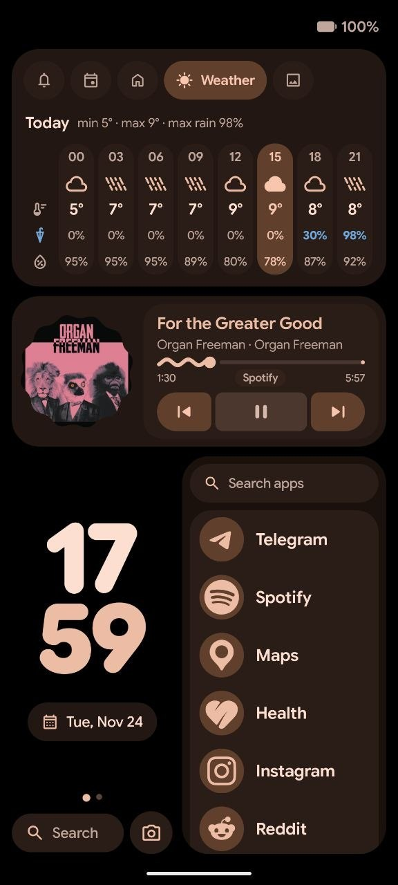
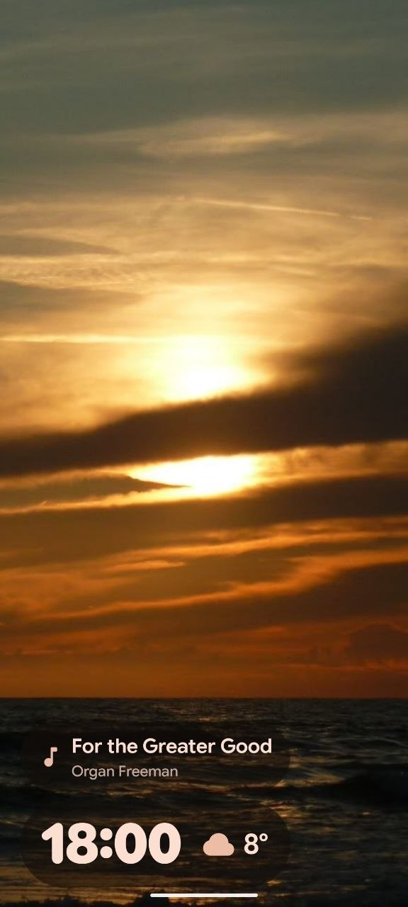
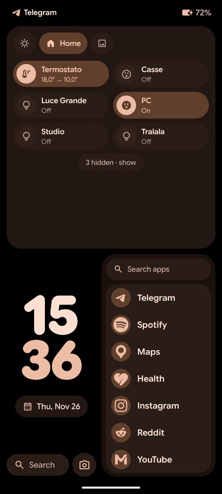
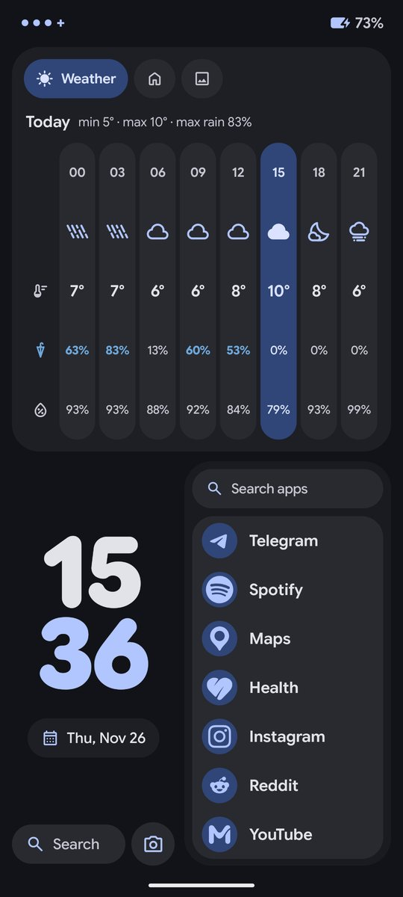
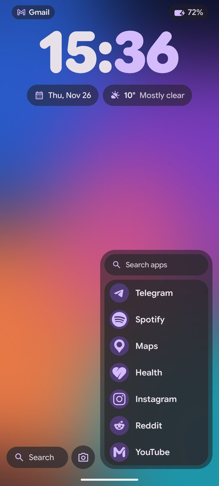
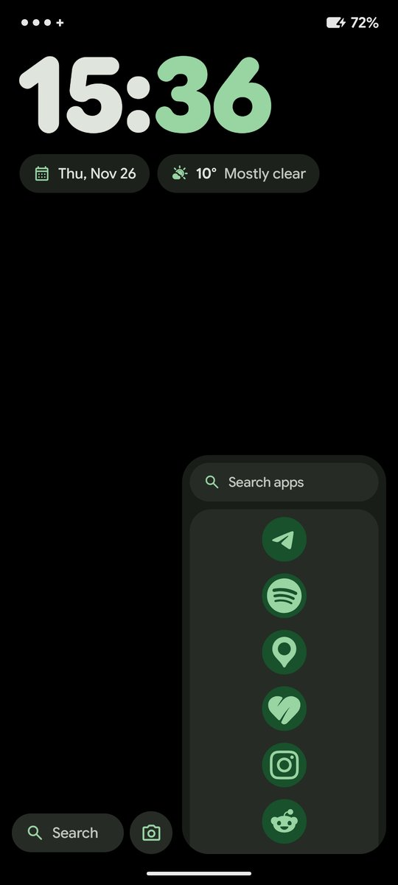
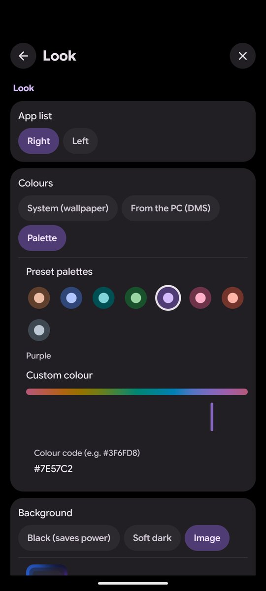

# sidecar_launcher

**Sidecar Launcher** — a low-power portrait Android launcher with the look of
[desk_sidecar](https://github.com/ciabattarichri/desk_sidecar) and the PC's
[DankMaterialShell](https://github.com/AvengeMedia/DankMaterialShell): black AMOLED background,
rounded pills, Material 3 colours. No app drawer: widgets, clock and the full app list share one
screen.

> **Beta (v0.x).** Built and tested on a Pixel 8 (Android 17), also tried on Pixel 9 and 9a. Other phones work but the layout is
> tuned for 20:9 screens.

<p align="center">
  
  &nbsp;
  
</p>

Some of the looks you can pick in the settings:

<p align="center">
  
  
  
  
  
</p>
<p align="center"><sub>System colours · blue palette, soft dark · image background, clock on top · green, icons only · settings</sub></p>

## Layout

```
┌───────────────────────────────┐
│                    ⚡ 100%     │  battery (system status bar hidden by default)
│ ┌───────────────────────────┐ │
│ │ 🔔 📅 Agenda 🏠 ☀ 🖼        │ │  widgets: notifications · agenda or month calendar
│ │                           │ │           Google Home or Home Assistant · weather · photos
│ └───────────────────────────┘ │
│ ┌───────────────────────────┐ │  player (only while something plays,
│ │ ◎ title · artist  ⏮ ⏯ ⏭   │ │  or double-tap the widgets)
│ └───────────────────────────┘ │
│   17      ┌────────────────┐  │
│   42      │ 🔍 Search apps │  │  clock (swipe: billable hours, rolling)
│ [Tue 24]  │ ★ pinned apps  │  │  app list A–Z, pinned on top
│ [🔍][📷]  │ A … Z          │  │  search (Google or a browser) · camera, both optional
└───────────────────────────────┘
```

The app list moves to the left in left-handed mode.

## Gestures

| Where | Gesture | Action |
|---|---|---|
| anywhere | pinch in (two fingers) | launcher settings |
| anywhere not scrolling | swipe down | notification shade |
| custom status bar | tap | notification shade |
| app | tap / long press | open / app info, or a menu: rename, pin, hide, app info, uninstall |
| app | swipe right / left | pin–unpin / hide |
| "Search apps" | type | search (custom and original names), hidden apps included; Enter opens the first, or optionally the only match opens by itself |
| clock | long press / swipe | Clock app / next page (billable hours) |
| widgets (or the top half with the clock on top) | double tap, also over lists and buttons | show/hide the player; with no media session, an empty player that opens the last music app |
| widget | long press | Calendar, Google Home, Weather, notification history; **Photos → full-screen slideshow** with clock, now playing and synced lyrics |
| month calendar | arrows or vertical swipe / tap a day / tap the title | change month / that day's events / back to today |
| Home widget device | tap / long press | toggle / hide |

## Settings

Grouped in categories: look (side; colours from the system, the PC (when paired) or a palette — 8
presets or any custom colour, generated with the Material You algorithm so they work on any phone;
background (black, soft dark or an image, with DMS-style adjustable card and pill transparency);
custom status bar (battery + notifications as dots or a rolling carousel, theme colours or white on
black, optional pill) or the system one; gesture bar; app list width, icons and names / icons only (a
centred column) / names only, icon and name size, themed icons; language system/IT/EN), animations,
widgets & clock pages (no widget tabs → the clock moves to the top: left, centre or right; the clock
can also be removed altogether; search pill opening Google or a browser, and camera button, each
optional), apps (pinned, hidden, renamed; long press = app info or menu; open the only search match, after an adjustable 0–1 s pause),
calendars (agenda list or month view), Google Home or Home Assistant (URL + long-lived token) /
weather / Billable Hours (only with a Pebble app installed), photos (gallery, or the PC folder when paired; album, duration, lyrics), system shortcuts
(notification access, default launcher, black home wallpaper). Options that depend on another choice
stay visible but greyed out, with a note. First run (and updates that add options) asks how you want
the status and gesture bars.

## With the PC (optional)

Photos from the PC slideshow folder, the PC's matugen palette and the Billable Hours settings come
from `phonedash` in desk_sidecar (pull server on port 8766, token-protected, Tailscale or LAN):

```sh
phonedash pair-launcher     # phone on USB; confirm "Pair with this PC?" on the phone
```

## Power

Built to do nothing while you don't look at it: minute-precision clock, every refresh loop paused
when the launcher isn't on screen, stepped player animations (30 s window by default), black
background. Measured on the Pixel 8: ~0.2% of one core and 1 frame per minute idle, no alarms, jobs
or wakelocks.

## Build and install

```sh
./gradlew assembleRelease
adb install -r app/build/outputs/apk/release/app-release.apk
adb shell cmd notification allow_listener dev.vq.sidecarlauncher/dev.vq.sidecarlauncher.PhoneListener
adb shell cmd package compile -m speed-profile -f dev.vq.sidecarlauncher   # precompile (faster, lighter)
```

Then *Settings → Apps → Default apps → Home app → Sidecar Launcher*. Without adb, notification
access needs *App info → ⋮ → Allow restricted settings* first. Quick guide in Italian:
[`release/GUIDA.md`](release/GUIDA.md). Releases: `scripts/make-release.sh` → [release/](release).

Requirements: Android 13+ (API 33); build with JDK 21+ and Android SDK platform 37.

## License

[PolyForm Noncommercial 1.0.0](LICENSE.md): free for any noncommercial use, commercial use not
allowed. Fonts keep their own licenses — see [THIRD_PARTY_NOTICES.md](THIRD_PARTY_NOTICES.md).
Written largely with an AI coding assistant (Claude Code), under human direction and review.
